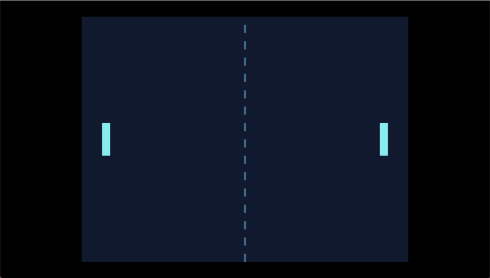
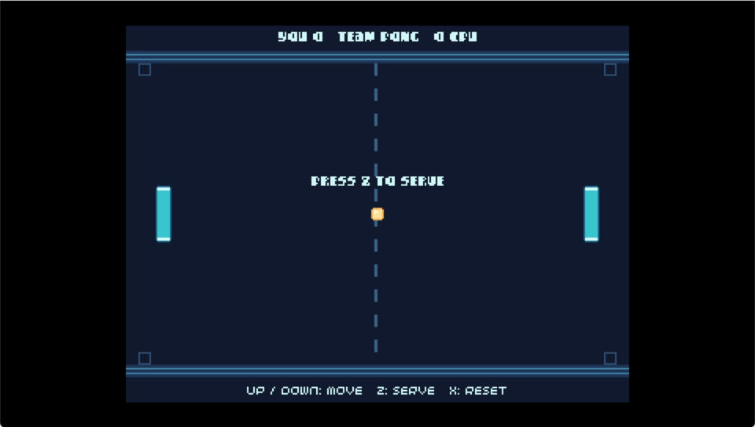

# Make Pong with the 32blit SDK

Start with an empty game loop and build a playable Pong game one change at a time. Continue into the [scene-driven edition](#build-the-scene-driven-edition) to use prefab defaults, authored colliders, sprite clips, and a tilemap. [The completed project](../examples/team-pong/) is available separately so you can compare your work at any point. In the Windows kit it is the `team-pong` folder; **Play Pong.cmd** runs its prebuilt executable.

**Want to start in the editor?** In the Windows kit, double-click **Build Pong in Editor.cmd**, then jump to [Set up Pong in the editor](#set-up-pong-in-the-editor). No compiler needed for that route.

## 0. Start with a blank window

Install Visual Studio or Build Tools with **Desktop development with C++**, CMake 3.21+, and Python. Clone the SDK on the `world-storage` branch if you only have the ZIP; the ZIP includes the editor, games, and tutorial source, not the SDK toolchain. In Developer PowerShell, set `$sdk` to the full path of your SDK checkout:

```powershell
$sdk = 'C:\src\32blit-sdk' # Change this to your checkout
py -m pip install '32blit==0.7.4' 'bitstring<5'
Copy-Item "$sdk\examples\pong-starter" .\my-pong -Recurse
Set-Location .\my-pong
cmake -S . -B build-windows "-D32BLIT_DIR=$sdk" "-DSDL2_DIR=$sdk/vs/sdl"
```

Use this build/run pair at **every checkpoint**. Close the previous game window before rebuilding:

```powershell
cmake --build build-windows --config Debug --target pong_starter
.\build-windows\Debug\pong_starter.exe
```

Open `pong.cpp` in your text editor. The starter has three callbacks: `init` sets a 320 × 240 display, `update` is called every 10 ms, and `render` clears the screen. **Checkpoint:** a blank navy window opens. If CMake cannot find the SDK, check that `$sdk\32blit-config.cmake` exists.

The first background is not an image. `screen.pen = Pen(16, 25, 45);` picks a navy RGB color, and `screen.clear();` fills the whole window with it every frame. The scene-driven game uses the same navy fill under its tilemap, so empty cells show navy in the game even though the editor canvas is light gray.


## 1. Draw the court and move the left paddle

Add `#include <algorithm>` after the `32blit.hpp` include. Add these variables after `using namespace blit;`. Coordinates start at the top left, and Y grows downward. Store paddle positions as floats so fractional movement carries across updates.

```cpp
constexpr int court_width = 320, court_height = 240;
constexpr int left_x = 20, right_x = 292, paddle_w = 8, paddle_h = 32;
constexpr float dt = 0.010f;
float left_y = 104, right_y = 104;
```

Replace the empty `update` with this function:

```cpp
void update(uint32_t) {
  const int direction = bool(buttons & Button::DPAD_DOWN) - bool(buttons & Button::DPAD_UP);
  left_y = std::clamp(left_y + direction * 170.0f * dt, 0.0f, float(court_height - paddle_h));
}
```

In `render`, add these lines **after** `screen.clear();`:

```cpp
  screen.pen = Pen(68, 107, 144);
  for (int y = 8; y < court_height; y += 16)
    screen.rectangle(Rect(court_width / 2 - 1, y, 2, 8));
  screen.pen = Pen(137, 235, 240);
  screen.rectangle(Rect(left_x, int(left_y), paddle_w, paddle_h));
  screen.rectangle(Rect(right_x, int(right_y), paddle_w, paddle_h));
```

**Checkpoint:** Up/Down moves only the left paddle. Holding a direction stops it at the screen edge.



## 2. Serve a ball and bounce off the court

Add the ball state after the paddle variables. The ball position is its top-left corner. Its velocity is in pixels per second.

```cpp
constexpr int ball_size = 8;
constexpr float serve_x = (court_width - ball_size) / 2.0f;
constexpr float serve_y = (court_height - ball_size) / 2.0f;
float ball_x = serve_x, ball_y = serve_y;
float vx = 0, vy = 0;
bool waiting = true;

void reset_ball() {
  ball_x = serve_x;
  ball_y = serve_y;
  waiting = true;
}
```

Append this inside `update`, after the paddle movement:

```cpp
  if (waiting) {
    if (!(buttons.pressed & Button::A)) return;
    vx = -190.0f;
    vy = 180.0f;
    waiting = false;
  }
  ball_x += vx * dt;
  ball_y += vy * dt;
  if (ball_y < 0 && vy < 0) { ball_y = 0; vy = -vy; }
  if (ball_y > court_height - ball_size && vy > 0) {
    ball_y = court_height - ball_size;
    vy = -vy;
  }
  if (ball_x + ball_size < 0 || ball_x > court_width) reset_ball();
```

Append this inside `render`, after the paddles:

```cpp
  screen.pen = Pen(255, 222, 139);
  screen.rectangle(Rect(int(ball_x), int(ball_y), ball_size, ball_size));
  if (waiting) screen.text("Z TO SERVE", minimal_font, Point(116, 96));
```

**Checkpoint:** Z serves the ball down and left, it reflects from the bottom edge, and crossing the left side returns it to the center. Paddles still do not hit it.

## 3. Add paddle collisions, a CPU opponent, and scoring

Add `#include <cstdio>` for the scoreboard, and add `unsigned you = 0, cpu = 0;` alongside the game state. Replace the **entire** `update` function with this version. It compares the ball's previous and new edge to each paddle face, so merely touching a paddle from behind doesn't reverse the ball. A hit near the paddle end gives the ball more vertical speed.

```cpp
void update(uint32_t) {
  const int direction = bool(buttons & Button::DPAD_DOWN) - bool(buttons & Button::DPAD_UP);
  left_y = std::clamp(left_y + direction * 170.0f * dt, 0.0f, float(court_height - paddle_h));
  if (buttons.pressed & Button::B) {
    you = cpu = 0;
    reset_ball();
    return;
  }
  if (waiting) {
    if (!(buttons.pressed & Button::A)) return;
    vx = (you + cpu) % 2 ? 190.0f : -190.0f;
    vy = 74.0f;
    waiting = false;
  }

  const float old_x = ball_x;
  ball_x += vx * dt;
  ball_y += vy * dt;
  if (ball_y < 0 && vy < 0) { ball_y = 0; vy = -vy; }
  if (ball_y > court_height - ball_size && vy > 0) {
    ball_y = court_height - ball_size;
    vy = -vy;
  }

  const float target_y = ball_y + ball_size / 2.0f - paddle_h / 2.0f;
  right_y = std::clamp(right_y + std::clamp(target_y - right_y, -95.0f * dt, 95.0f * dt),
                       0.0f, float(court_height - paddle_h));
  const auto overlaps = [](float paddle_y) {
    return ball_y < paddle_y + paddle_h && ball_y + ball_size > paddle_y;
  };
  const auto bounce = [](float paddle_y) {
    vx = -vx;
    const float hit = (ball_y + ball_size / 2.0f - paddle_y - paddle_h / 2.0f) / (paddle_h / 2.0f);
    vy = std::clamp(hit, -1.0f, 1.0f) * 150.0f;
  };
  if (vx < 0 && old_x >= left_x + paddle_w && ball_x <= left_x + paddle_w && overlaps(left_y)) {
    ball_x = left_x + paddle_w;
    bounce(left_y);
  } else if (vx > 0 && old_x + ball_size <= right_x && ball_x + ball_size >= right_x && overlaps(right_y)) {
    ball_x = right_x - ball_size;
    bounce(right_y);
  }
  if (ball_x + ball_size < 0) { ++cpu; reset_ball(); }
  else if (ball_x > court_width) { ++you; reset_ball(); }
}
```

Append this inside `render`, after the serve prompt:

```cpp
  char score[48];
  std::snprintf(score, sizeof(score), "YOU %u   CPU %u", you, cpu);
  screen.pen = Pen(208, 248, 248);
  screen.text(score, minimal_font, Point(105, 8));
```

**Checkpoint:** Use Up/Down to return a serve, deliberately miss to give the CPU a point, serve again, then press X to reset the score. You now have a complete game: input, a rally, an opponent, scoring, and restart.


## Build the scene-driven edition

The completed **Team Pong** project uses the same rules with authored actors and art. Keep your scratch project separate. The supplied `pong.cpp` is the runtime scaffold for this edition; you do not need to retype its file loaders. Compare your `update` to the reference: it reads positions from `Transform2D`, dimensions from `BoxCollider2D`, and speeds from `PaddleDrive` instead of hard-coded paddle variables. The reference `render` draws the tilemap and walks `Transform2D` + `Sprite` entities rather than drawing rectangles.



### Start with art but no authored level

For a hands-on rebuild, copy only the runtime scaffold, manifest, and PNGs into a new project. In a new Developer PowerShell, set `$sdk` again, then run this from a folder where `pong-authoring` does not exist:

```powershell
$reference = "$sdk\examples\team-pong"
New-Item -ItemType Directory .\pong-authoring, .\pong-authoring\assets, .\pong-authoring\scenes
foreach ($file in 'CMakeLists.txt','CMakePresets.json','blit-project.json','assets.yml','metadata.yml','pong.cpp','paddle.cpp','paddle.hpp') {
    Copy-Item "$reference\$file" .\pong-authoring\
}
Copy-Item "$reference\assets\*.png" .\pong-authoring\assets\
Set-Content .\pong-authoring\scenes\pong.scene 'scene 1 Pong' -Encoding ascii
Set-Location .\pong-authoring
cmake --preset windows "-D32BLIT_DIR=$sdk" "-DSDL2_DIR=$sdk/vs/sdl"
cmake --build build-windows --config Debug --target team_pong
```

Open this folder with `32blit-editor.exe --project .` (use the full path to your editor executable). If you're using **Build Pong in Editor.cmd** from the Windows kit, skip the PowerShell setup above: that launcher opens a separate project with a blank scene, a registry, the source PNGs, and a prebuilt game. Neither route modifies the completed reference.

### Set up Pong in the editor

The **2D Viewport** should show `scenes/pong.scene` with no actors. **Prefabs**, **Entities**, and **Layers** are in the right dock; **Tilesets** is in the bottom dock and **Sprites** is in the main dock. If a tab is hidden, use its dock's **+** menu to open it. Drag the divider to make a cramped panel taller or wider.

#### A. Create the sprite clips first

1. Click **Sprites**, then the **+** inside the Sprites panel. In the PNG list, select `assets/paddles.png`. Replace **Sprite file** with `assets/paddle.sprite.json` and click **Create draft**. The PNG is the input; the JSON is a new asset, not a replacement for the PNG.
2. In the new tab, click **Sheet settings**, enter `10` and `36` in **Frame size (px)**, and click **Apply grid**. The atlas should show two tall paddle cells. Hover a cell to see its zero-based number, or enter the number in **Cell (zero-based)**.
3. Select cell `0`. In **Named clips**, type `pulse` in **Name** and click **Add clip**. This adds the selected cell as the first frame. Select cell `1` in the atlas and click **Append picked cell** under **Frames**. In the frame list, select row 1 and set **Duration (ms)** to `440`; select row 2 and set it to `220`. Scroll the right half of the panel if the duration field is below the preview. Leave **Loop** checked and click **Play** to check that it alternates.
4. Select cell `0` again, enter `steady` in **Name**, and click **Add clip**. Set its only frame to `440` ms. Use **File → Save Sprite** while the Sprites panel is focused.
5. In **Sprites**, click **+** again, select `assets/ball.png`, set **Sprite file** to `assets/ball.sprite.json`, and click **Create draft**. Keep the `8 × 8` grid. Pick cell `0`, enter `spin`, and click **Add clip**. Pick cell `1` and click **Append picked cell**. Leave **Loop** checked and both durations at `100` ms. Click **Play** to see the ball alternate, then **File → Save Sprite**.


#### B. Add a paddle prefab with defaults

1. Return to **2D Viewport**. Click **Prefabs → Add Prefab**, enter `paddle` in **Key**, and click **Create**. Expand the `paddle` row to expose **Add Component**.
2. Choose **Add Component → Transform2D** and click **Add** with all boxes unchecked. Do the same for **PaddleDrive**. Unchecked fields use the C++ defaults; you will override the opponent's values later.
3. Choose **Add Component → Sprite**. In the **Add Sprite** popup, check each field below to reveal its input, replace the value, then click **Add**. Repeat with **BoxCollider2D**.

   | Component | Fields to check and fill |
   |---|---|
   | `Sprite` | `asset` = `assets/paddle`; `clip` = `pulse`; `offset_x` = `-5`; `offset_y` = `-18` |
   | `BoxCollider2D` | `width` = `10`; `height` = `36`; `offset_x` = `-5`; `offset_y` = `-18` |

   Leave `.sprite.json` off the `asset` value. The offsets center both artwork and collider on the paddle's position. The prefab itself does not appear in the scene until you create instances.

#### C. Place the player, opponent, and ball

1. Click **Entities → Add Entity**. Enter `player` in **Key**, choose `paddle` from **Prefab**, and click **Create**. Select `player` in the list if it is not selected. Under **Transform2D**, click the **Edit** button below `x`, enter `24`, and click **Set**. Repeat for `y` with `120`. Use each field's own **Edit** button, not **Add Component** for inherited components.
2. Repeat **Add Entity** with the key `opponent` and prefab `paddle`. Set `x` to `296` and `y` to `120`. Scroll down its inspector and use **Edit → Set** on `PaddleDrive.computer` (`true`), `PaddleDrive.speed` (`92`), and `Sprite.clip` (`steady`). These are local overrides; the player still inherits the original values.
3. Click **Add Entity**, enter `ball`, leave **Prefab** at **None**, and click **Create**. Select `ball`. Use **Add Component** three times to add `Transform2D`, `Sprite`, and `BoxCollider2D`. On entities, each component is added immediately. Use each field's **Edit → Set** to enter:

   | Component | Values |
   |---|---|
   | `Transform2D` | `x=160`, `y=120` |
   | `Sprite` | `asset=assets/ball`, `clip=spin`, `offset_x=-4`, `offset_y=-4` |
   | `BoxCollider2D` | `width=8`, `height=8`, `offset_x=-4`, `offset_y=-4` |

4. Choose **File → Save All**. Click **Fit Screen** in **2D Viewport** if needed. You should see a paddle on each side and the ball in the center. Select an actor to see its orange collider outline. The viewport shows a still frame; **Sprites → Play** previews motion. [Compare the finished scene file](../examples/team-pong/scenes/pong.scene) if anything is missing.

#### D. Add the court background and run the game

The game supplies the flat navy background in C++. Here you create the **tilemap layer above it** for the court lines. You don't need to paint every cell navy.

1. Click **Tilesets**, then the **+** inside that panel. In **Project PNG**, choose `assets/court.png`; set **Tileset file** to `assets/court.tileset.json` and **Tile size (px)** to `8`. Click **Import**. Leave tile properties empty: these tiles are decorative.
2. Go to **2D Viewport** and click the **+ beside the `scenes/pong.scene` tab**, not the dock's +. Select **New Tilemap**. Set **Path** to `scenes/pong.map`, **Width / Height (cells)** to `40` and `30`, and **Tileset** to `assets/court.tileset.json`. Click **Create**. Matching the scene's folder and basename is what associates the map with the scene.
3. In the map tab, click **Fit Map**. Open **Layers** and click the **Ground** name; keep its visibility checkbox checked. Go to **Tilesets** and pick a visible swatch; hover to see its tile number. In **2D Viewport**, turn **Paint** on if it is off, then click a cell to place the first tile. For example, use **Tile 4** to mark the sides of the court: counting from the top left as column 0, row 0, place a line near row 2, another near row 27, and a dash every other row near column 20. You can paint a shorter line to test first. Use **Eraser** to clear a cell. These decorations do not set the physics boundaries.
4. Choose **File → Save All**, then switch back to `scenes/pong.scene` to see the court behind the actors. In the Windows kit, click the **Play** menu item at the very top of the editor (not the animation preview button). If you built from source, you can instead run `.\build-windows\Debug\team_pong.exe` from `pong-authoring`.
5. Press **Z** to serve and **Up/Down** or **W/S** to move. The instructions require all three actors, both sprite descriptors, and the map with its tileset link. If the game says it cannot load the project, compare those filenames with the completed reference. After changing an asset, save, stop the running game, and play again.


The following reference notes are also useful if you start by exploring the completed project instead of rebuilding the authored level.


## Build and play on Windows

Install Visual Studio or Build Tools with **Desktop development with C++**, CMake 3.21 or newer, and Python. From a Developer PowerShell with the SDK checkout as the current directory:

```powershell
py -m pip install '32blit==0.7.4' 'bitstring<5'
Set-Location .\examples\team-pong
cmake --preset windows
cmake --build build-windows --config Debug --target team_pong
.\build-windows\Debug\team_pong.exe
```

The first configure can download pinned dependencies. The SDK supplies the SDL packages for the Visual Studio build. If you copy `team-pong` out of the SDK, CMake also finds a sibling directory named `32blit-sdk`. For any other layout, configure with `cmake --preset windows "-D32BLIT_DIR=C:/src/32blit-sdk"` using the directory containing `32blit-config.cmake`. Run the executable **from the `team-pong` project directory** so it can read `scenes/` and the sprite descriptors in `assets/`.

| Keyboard | Gamepad | Action |
| --- | --- | --- |
| Up/Down arrows or W/S | D-pad Up/Down | Move the left paddle |
| Z or U | A | Serve when the game is waiting |
| X or I | B | Clear the score and return the ball to its serve position |

Press **Z** to start. The first serve comes toward you. Meet the ball near the end of your paddle to send it back at a steeper angle. After either player scores, press **Z** to serve again.

## Open the project in the editor

Build the game first: it exports `build-windows/registry.json`, so the editor knows about `PaddleDrive` as well as the built-in components. You can also export just the registry with `cmake --build build-windows --config Debug --target team_pong_registry`.

Build the [desktop editor](../editor/README.md) and open the sample, or use **Edit Pong.cmd** in the Windows kit. From the **SDK root**, using the editor build in that guide:

```powershell
.\build-editor\Release\32blit-editor.exe --project .\examples\team-pong
```

`blit-project.json` selects the startup scene and launch settings. Use **File → Save All** before playing. In the kit, **Play** launches the bundled game; a source checkout configures and builds it. Use **Stop** before starting again to see saved edits. C++ and packed PNG changes require a source rebuild.

## 1. Place actors and reuse a paddle prefab

Open `scenes/pong.scene` in **2D Viewport**. It contains three entities: `player`, `opponent`, and `ball`. The first two are instances of `paddle`, a prefab in the same scene. Select it in **Prefabs** to see the shared components:

```text
prefab paddle
  Transform2D
  Sprite asset=assets/paddle clip=pulse offset_x=-5 offset_y=-18
  BoxCollider2D width=10 height=36 offset_x=-5 offset_y=-18
  PaddleDrive
```

- `Transform2D` places an actor in the 320 × 240 court, with x increasing to the right and y increasing down. The entity supplies its own starting `x` and `y`.
- `Sprite` names the art and clip. The offsets center the 10 × 36 paddle on its transform.
- `BoxCollider2D` matches the artwork. Select a paddle entity to see its orange outline. The box is data; `pong.cpp` decides what happens when the ball hits it.
- `PaddleDrive` holds a `speed` in pixels per second and a `computer` flag. The player uses the C++ defaults; the opponent sets `computer=true` and its own slower speed. The opponent also overrides `Sprite.clip` to `steady`. An entity override wins over the prefab, which wins over the C++ default.

Try selecting `player` in **Entities** and setting `Transform2D.y` to `160`. Save and play: only the left paddle starts lower. Then try setting `PaddleDrive.speed` on the opponent to `65`. The computer should have more trouble returning angled shots. You can also edit the same `.scene` file in an external text editor and use **Reload** from its clean scene tab to pick up the changes.

## 2. Change a sprite clip

Open `assets/paddle.sprite.json` from **Project Files**. In **Sprites**, select `pulse`, select its second frame, and change **Duration (ms)** from `220` to `600`. Preview the clip, save the sprite, and play. The player's brighter frame lasts longer; the opponent's single-frame `steady` clip does not change.

The `.sprite.json` describes the PNG, frame dimensions, clip cells, timings, and loop option. `Sprite.asset` names the descriptor without `.sprite.json`. Pong uses separate PNGs for its full 10 × 36 paddles and 8 × 8 ball frames. The editor saves clip data, not pixels; CMake packs the PNG artwork through `assets.yml`.

## 3. Paint the court

Open `scenes/pong.map` in **2D Viewport** to edit it on its own, or paint the same map behind `pong.scene`. The shared basename links the map to the scene in the editor. `scenes/pong.map.json` points to `assets/court.tileset.json`, which references `assets/court.png`.

1. In **Layers**, click the name **Court** to make it the paint target. Leave the visibility checkbox checked.
2. In **Tilesets**, choose the gold swatch (hover to see **Tile 4**). Turn **Paint** on in **2D Viewport** and click an empty cell inside the court. Try **Eraser** to clear it.
3. With the map tab active, use **File → Save Map**, or use **File → Save All**. Restart the game and look for the new tile.

BTMP stores cell placement, and the associated tileset sets cell size. Pong’s supplied court uses 8 × 8 cells. Its runtime reads the tileset geometry and draws the packed court atlas with `MapLayer::draw`. The simulation still bounces the ball at y=24 and y=216 regardless of what you paint.

## 4. Edit C++ from the editor

In **Project Files**, open `paddle.hpp` in **Documents**, replace `170.0f` with `230.0f` on the `speed` line, and choose **File → Save Document** (Ctrl+S with **Documents** focused). Save any other edits and click **Play**, or rebuild and launch from PowerShell. The player inherits the new default unless its entity or prefab sets `speed`; the opponent keeps its authored override. Saving source changes the project file but does not compile it. If a file has changed externally since you opened it, the editor refuses to overwrite the newer version; copy out any draft changes you want to keep, then discard and reopen the tab before merging them.

To follow the code, start in `pong.cpp`:

1. `init()` attaches component pools to a `sdk::World` and loads the authored scene through `sdk::SceneRuntime`. `SDK_COMPONENT(PaddleDrive, speed, computer)` in `paddle.cpp` registers the fields for scene loading and the editor's registry exporter. Registering a component does not add behavior.
2. `update()` runs every 10 ms. It moves the ball, moves paddles using their `PaddleDrive`, and reads the transforms plus collider offsets and sizes as rectangles. A crossing of a paddle face with vertical overlap reverses horizontal direction; the vertical bounce speed depends on where the ball hit the paddle. Once the ball leaves a side, the other side scores and the ball returns to its authored serve position.
3. `render()` draws the map, then every entity with both a `Transform2D` and a `Sprite`, then the score and controls.

You can also author this project in the browser editor: import a project ZIP containing `blit-project.json`, the source and assets, and the exported `registry.json` (for example, copy `build-windows/registry.json` to the archive root). **Save All** and **Export Project ZIP** to keep your edits. Build or run the game from an extracted copy on the desktop; the browser editor does not launch or compile it.
