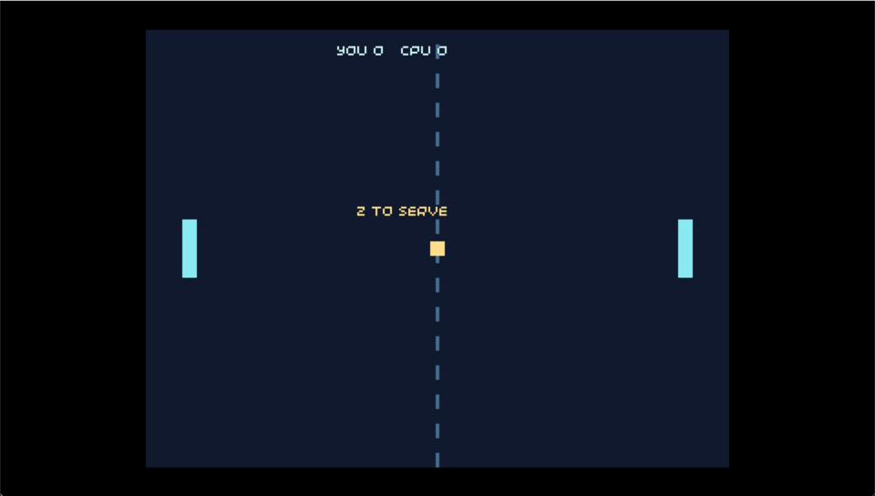
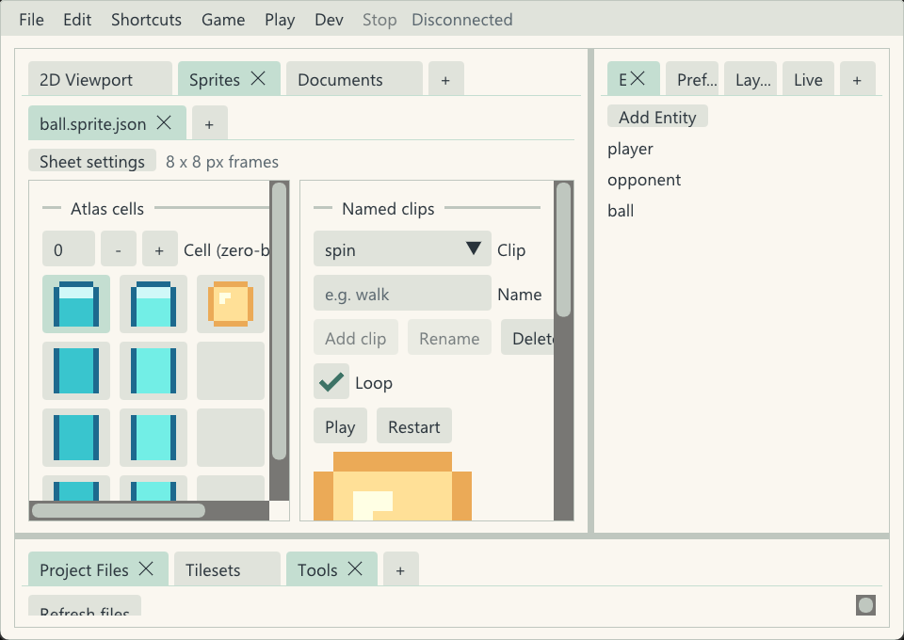
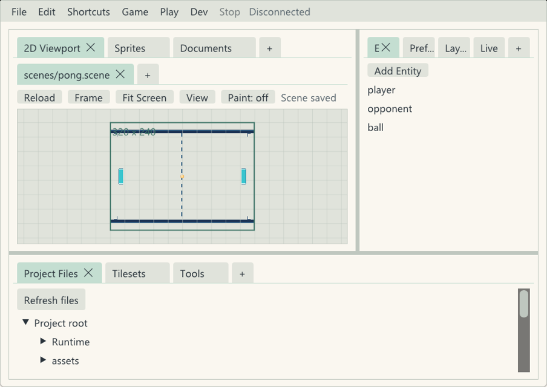

# Make Pong with the 32blit SDK

Start with an empty game loop and build a playable Pong game one change at a time. Continue into the [scene-driven edition](#build-the-scene-driven-edition) to use prefab defaults, authored colliders, sprite clips, and a tilemap. [The completed project](../examples/team-pong/) is available separately so you can compare your work at any point. In the Windows kit it is the `team-pong` folder; **Play Pong.cmd** runs its prebuilt executable.

## 0. Start with a blank window

Install Visual Studio or Build Tools with **Desktop development with C++**, CMake 3.21+, and Python. Clone the SDK on the `world-storage` branch if you only have the ZIP; the ZIP includes the editor, games, and tutorial source, not the SDK toolchain. In Developer PowerShell, set `$sdk` to the full path of your SDK checkout:

```powershell
$sdk = 'C:\src\32blit-sdk' # Change this to your checkout
py -m pip install '32blit==0.7.4' 'bitstring<5'
Copy-Item "$sdk\examples\pong-starter" .\my-pong -Recurse
Set-Location .\my-pong
cmake -S . -B build-windows "-D32BLIT_DIR=$sdk" "-DSDL2_DIR=$sdk/vs/sdl"
```

Use this build/run pair at **every checkpoint**. Close the previous game window before rebuilding:

```powershell
cmake --build build-windows --config Debug --target pong_starter
.\build-windows\Debug\pong_starter.exe
```

Open `pong.cpp` in your text editor. The starter has three callbacks: `init` sets a 320 × 240 display, `update` is called every 10 ms, and `render` clears the screen. **Checkpoint:** a blank navy window opens. If CMake cannot find the SDK, check that `$sdk\32blit-config.cmake` exists.


## 1. Draw the court and move the left paddle

Add `#include <algorithm>` after the `32blit.hpp` include. Add these variables after `using namespace blit;`. Coordinates start at the top left, and Y grows downward. Store paddle positions as floats so fractional movement carries across updates.

```cpp
constexpr int court_width = 320, court_height = 240;
constexpr int left_x = 20, right_x = 292, paddle_w = 8, paddle_h = 32;
constexpr float dt = 0.010f;
float left_y = 104, right_y = 104;
```

Replace the empty `update` with this function:

```cpp
void update(uint32_t) {
  const int direction = bool(buttons & Button::DPAD_DOWN) - bool(buttons & Button::DPAD_UP);
  left_y = std::clamp(left_y + direction * 170.0f * dt, 0.0f, float(court_height - paddle_h));
}
```

In `render`, add these lines **after** `screen.clear();`:

```cpp
  screen.pen = Pen(68, 107, 144);
  for (int y = 8; y < court_height; y += 16)
    screen.rectangle(Rect(court_width / 2 - 1, y, 2, 8));
  screen.pen = Pen(137, 235, 240);
  screen.rectangle(Rect(left_x, int(left_y), paddle_w, paddle_h));
  screen.rectangle(Rect(right_x, int(right_y), paddle_w, paddle_h));
```

**Checkpoint:** Up/Down moves only the left paddle. Holding a direction stops it at the screen edge.


## 2. Serve a ball and bounce off the court

Add the ball state after the paddle variables. The ball position is its top-left corner. Its velocity is in pixels per second.

```cpp
constexpr int ball_size = 8;
constexpr float serve_x = (court_width - ball_size) / 2.0f;
constexpr float serve_y = (court_height - ball_size) / 2.0f;
float ball_x = serve_x, ball_y = serve_y;
float vx = 0, vy = 0;
bool waiting = true;

void reset_ball() {
  ball_x = serve_x;
  ball_y = serve_y;
  waiting = true;
}
```

Append this inside `update`, after the paddle movement:

```cpp
  if (waiting) {
    if (!(buttons.pressed & Button::A)) return;
    vx = -190.0f;
    vy = 180.0f;
    waiting = false;
  }
  ball_x += vx * dt;
  ball_y += vy * dt;
  if (ball_y < 0 && vy < 0) { ball_y = 0; vy = -vy; }
  if (ball_y > court_height - ball_size && vy > 0) {
    ball_y = court_height - ball_size;
    vy = -vy;
  }
  if (ball_x + ball_size < 0 || ball_x > court_width) reset_ball();
```

Append this inside `render`, after the paddles:

```cpp
  screen.pen = Pen(255, 222, 139);
  screen.rectangle(Rect(int(ball_x), int(ball_y), ball_size, ball_size));
  if (waiting) screen.text("Z TO SERVE", minimal_font, Point(116, 96));
```

**Checkpoint:** Z serves the ball down and left, it reflects from the bottom edge, and crossing the left side returns it to the center. Paddles still do not hit it.

## 3. Add paddle collisions, a CPU opponent, and scoring

Add `#include <cstdio>` for the scoreboard, and add `unsigned you = 0, cpu = 0;` alongside the game state. Replace the **entire** `update` function with this version. It compares the ball's previous and new edge to each paddle face, so merely touching a paddle from behind doesn't reverse the ball. A hit near the paddle end gives the ball more vertical speed.

```cpp
void update(uint32_t) {
  const int direction = bool(buttons & Button::DPAD_DOWN) - bool(buttons & Button::DPAD_UP);
  left_y = std::clamp(left_y + direction * 170.0f * dt, 0.0f, float(court_height - paddle_h));
  if (buttons.pressed & Button::B) {
    you = cpu = 0;
    reset_ball();
    return;
  }
  if (waiting) {
    if (!(buttons.pressed & Button::A)) return;
    vx = (you + cpu) % 2 ? 190.0f : -190.0f;
    vy = 74.0f;
    waiting = false;
  }

  const float old_x = ball_x;
  ball_x += vx * dt;
  ball_y += vy * dt;
  if (ball_y < 0 && vy < 0) { ball_y = 0; vy = -vy; }
  if (ball_y > court_height - ball_size && vy > 0) {
    ball_y = court_height - ball_size;
    vy = -vy;
  }

  const float target_y = ball_y + ball_size / 2.0f - paddle_h / 2.0f;
  right_y = std::clamp(right_y + std::clamp(target_y - right_y, -95.0f * dt, 95.0f * dt),
                       0.0f, float(court_height - paddle_h));
  const auto overlaps = [](float paddle_y) {
    return ball_y < paddle_y + paddle_h && ball_y + ball_size > paddle_y;
  };
  const auto bounce = [](float paddle_y) {
    vx = -vx;
    const float hit = (ball_y + ball_size / 2.0f - paddle_y - paddle_h / 2.0f) / (paddle_h / 2.0f);
    vy = std::clamp(hit, -1.0f, 1.0f) * 150.0f;
  };
  if (vx < 0 && old_x >= left_x + paddle_w && ball_x <= left_x + paddle_w && overlaps(left_y)) {
    ball_x = left_x + paddle_w;
    bounce(left_y);
  } else if (vx > 0 && old_x + ball_size <= right_x && ball_x + ball_size >= right_x && overlaps(right_y)) {
    ball_x = right_x - ball_size;
    bounce(right_y);
  }
  if (ball_x + ball_size < 0) { ++cpu; reset_ball(); }
  else if (ball_x > court_width) { ++you; reset_ball(); }
}
```

Append this inside `render`, after the serve prompt:

```cpp
  char score[48];
  std::snprintf(score, sizeof(score), "YOU %u   CPU %u", you, cpu);
  screen.pen = Pen(208, 248, 248);
  screen.text(score, minimal_font, Point(105, 8));
```

**Checkpoint:** Use Up/Down to return a serve, deliberately miss to give the CPU a point, serve again, then press X to reset the score. You now have a complete game: input, a rally, an opponent, scoring, and restart.



## Build the scene-driven edition

The completed **Team Pong** project uses the same rules with authored actors and art. Keep your scratch project separate. The supplied `pong.cpp` is the runtime scaffold for this edition; you do not need to retype its file loaders. Compare your `update` to the reference: it reads positions from `Transform2D`, dimensions from `BoxCollider2D`, and speeds from `PaddleDrive` instead of hard-coded paddle variables. The reference `render` draws the tilemap and walks `Transform2D` + `Sprite` entities rather than drawing rectangles.


### Start with art but no authored level

For a hands-on rebuild, copy only the runtime scaffold, manifest, and PNGs into a new project. In a new Developer PowerShell, set `$sdk` again, then run this from a folder where `pong-authoring` does not exist:

```powershell
$reference = "$sdk\examples\team-pong"
New-Item -ItemType Directory .\pong-authoring, .\pong-authoring\assets, .\pong-authoring\scenes
foreach ($file in 'CMakeLists.txt','CMakePresets.json','blit-project.json','assets.yml','metadata.yml','pong.cpp','paddle.cpp','paddle.hpp') {
    Copy-Item "$reference\$file" .\pong-authoring\
}
Copy-Item "$reference\assets\*.png" .\pong-authoring\assets\
Set-Content .\pong-authoring\scenes\pong.scene 'scene 1 Pong' -Encoding ascii
Set-Location .\pong-authoring
cmake --preset windows "-D32BLIT_DIR=$sdk" "-DSDL2_DIR=$sdk/vs/sdl"
cmake --build build-windows --config Debug --target team_pong
```

Open this folder with `32blit-editor.exe --project .` (use the full path to your editor executable). The built game will not show a court until you save the required assets. Use the same game build and run commands shown below, but stay in `pong-authoring`.

1. **Prefabs:** Add `paddle` with `Transform2D`, `PaddleDrive`, `BoxCollider2D` (`width=10`, `height=36`, offsets `-5,-18`), and `Sprite` (`asset=assets/paddle`, `clip=pulse`, offsets `-5,-18`). Leave `PaddleDrive` unchecked to use C++ defaults. Create `player` and `opponent` from `paddle` at `(24,120)` and `(296,120)`. Set the opponent's `PaddleDrive` to `computer=true`, `speed=92`, and `Sprite.clip` to `steady`. Add `ball` at `(160,120)` with an 8 × 8 collider and `Sprite asset=assets/ball clip=spin`; both use offsets `-4,-4`. [Compare the scene file](../examples/team-pong/scenes/pong.scene).
2. **Sprites:** Create `assets/paddle.sprite.json` from `assets/paddles.png` and `assets/ball.sprite.json` from `assets/ball.png`. In **Sheet settings**, apply 10 × 36 for the paddle; keep 8 × 8 for the ball. Select the first cell before clicking **Add clip**, then use **Append picked cell** for additional frames. All three clips loop.

   | Descriptor | Clip | Cells in order | Durations (ms) |
   |---|---|---|---|
   | `paddle` | `pulse` | 0, 1 | 440, 220 |
   | `paddle` | `steady` | 0 | 440 |
   | `ball` | `spin` | 0, 1 | 100, 100 |

   The ball’s `spin` clip alternates between two frames every 100 ms. Click **Play** in **Sprites** to see it loop before launching the game. The ball’s movement and collider are separate from that animation.

   


3. **Court:** Use **Tilesets → +** to create `assets/court.tileset.json` from `assets/court.png`. In the 2D Viewport tab strip, choose **+ → New Tilemap**, name it `scenes/pong.map`, enter **40 × 30 cells**, and select the court tileset. Select its **Ground** layer, choose a brush in **Tilesets**, and paint a center line and court edges. Your court can look different from the reference; the runtime court boundaries are still fixed by `pong.cpp`.
4. **Finish:** Choose **File → Save All** and run `./build-windows/Debug/team_pong.exe` from `pong-authoring`. Check that both paddles and the ball appear, that Z serves, and that the scene and clip edits affect the next launch without a rebuild. If a sprite is missing, check its asset stem, clip name and frame dimensions; if the court is missing, check the map's name and project working directory.



The following reference notes are also useful if you start by exploring the completed project instead of rebuilding the authored level.


## Build and play on Windows

Install Visual Studio or Build Tools with **Desktop development with C++**, CMake 3.21 or newer, and Python. From a Developer PowerShell with the SDK checkout as the current directory:

```powershell
py -m pip install '32blit==0.7.4' 'bitstring<5'
Set-Location .\examples\team-pong
cmake --preset windows
cmake --build build-windows --config Debug --target team_pong
.\build-windows\Debug\team_pong.exe
```

The first configure can download pinned dependencies. The SDK supplies the SDL packages for the Visual Studio build. If you copy `team-pong` out of the SDK, CMake also finds a sibling directory named `32blit-sdk`. For any other layout, configure with `cmake --preset windows "-D32BLIT_DIR=C:/src/32blit-sdk"` using the directory containing `32blit-config.cmake`. Run the executable **from the `team-pong` project directory** so it can read `scenes/` and the sprite descriptors in `assets/`.

| Keyboard | Gamepad | Action |
| --- | --- | --- |
| Up/Down arrows or W/S | D-pad Up/Down | Move the left paddle |
| Z or U | A | Serve when the game is waiting |
| X or I | B | Clear the score and return the ball to its serve position |

Press **Z** to start. The first serve comes toward you. Meet the ball near the end of your paddle to send it back at a steeper angle. After either player scores, press **Z** to serve again.

## Open the project in the editor

Build the game first: it exports `build-windows/registry.json`, so the editor knows about `PaddleDrive` as well as the built-in components. You can also export just the registry with `cmake --build build-windows --config Debug --target team_pong_registry`.

Build the [desktop editor](../editor/README.md) and open the sample, or use **Edit Pong.cmd** in the Windows kit. From the **SDK root**, using the editor build in that guide:

```powershell
.\build-editor\Release\32blit-editor.exe --project .\examples\team-pong
```

`blit-project.json` tells the editor to open `scenes/pong.scene` and use the sample's Windows build settings. Use **File → Save All** to write your authoring changes. **Play** builds and starts a fresh Debug game; use **Stop** before starting it again to see changes made during a session. If you run the game from PowerShell instead, relaunch it after changing the scene, map, or sprite descriptors. Only changes to C++ or packed PNG artwork need a rebuild.

## 1. Place actors and reuse a paddle prefab

Open `scenes/pong.scene` in **2D Viewport**. It contains three entities: `player`, `opponent`, and `ball`. The first two are instances of `paddle`, a prefab in the same scene. Select it in **Prefabs** to see the shared components:

```text
prefab paddle
  Transform2D
  Sprite asset=assets/paddle clip=pulse offset_x=-5 offset_y=-18
  BoxCollider2D width=10 height=36 offset_x=-5 offset_y=-18
  PaddleDrive
```

- `Transform2D` places an actor in the 320 × 240 court, with x increasing to the right and y increasing down. The entity supplies its own starting `x` and `y`.
- `Sprite` names the art and clip. The offsets center the 10 × 36 paddle on its transform.
- `BoxCollider2D` matches the artwork. Select a paddle entity to see its orange outline. The box is data; `pong.cpp` decides what happens when the ball hits it.
- `PaddleDrive` holds a `speed` in pixels per second and a `computer` flag. The player uses the C++ defaults; the opponent sets `computer=true` and its own slower speed. The opponent also overrides `Sprite.clip` to `steady`. An entity override wins over the prefab, which wins over the C++ default.

Try selecting `player` in **Entities** and setting `Transform2D.y` to `160`. Save and play: only the left paddle starts lower. Then try setting `PaddleDrive.speed` on the opponent to `65`. The computer should have more trouble returning angled shots. You can also edit the same `.scene` file in an external text editor and use **Reload** from its clean scene tab to pick up the changes.

## 2. Change a sprite clip

Open `assets/paddle.sprite.json` from **Project Files**. In **Sprites**, select `pulse`, select its second frame, and change **Duration (ms)** from `220` to `600`. Preview the clip, save the sprite, and play. The player's brighter frame lasts longer; the opponent's single-frame `steady` clip does not change.

The `.sprite.json` describes the PNG, frame dimensions, clip cells, timings, and loop option. `Sprite.asset` names the descriptor without `.sprite.json`. Pong uses separate PNGs for its full 10 × 36 paddles and 8 × 8 ball frames. The editor saves clip data, not pixels; CMake packs the PNG artwork through `assets.yml`.

## 3. Paint the court

Open `scenes/pong.map` in **2D Viewport** to edit it on its own, or paint the same map behind `pong.scene`. The shared basename links the map to the scene in the editor. `scenes/pong.map.json` points to `assets/court.tileset.json`, which references `assets/court.png`.

1. In **Layers**, click the name **Court** to make it the paint target. Leave the visibility checkbox checked.
2. In **Tilesets**, choose the gold swatch (hover to see **Tile 4**). Turn **Paint** on in **2D Viewport** and click an empty cell inside the court. Try **Eraser** to clear it.
3. With the map tab active, use **File → Save Map**, or use **File → Save All**. Restart the game and look for the new tile.

BTMP stores cell placement, and the associated tileset sets cell size. Pong’s supplied court uses 8 × 8 cells. Its runtime reads the tileset geometry and draws the packed court atlas with `MapLayer::draw`. The simulation still bounces the ball at y=24 and y=216 regardless of what you paint.

## 4. Edit C++ from the editor

In **Project Files**, open `paddle.hpp` in **Documents**, replace `170.0f` with `230.0f` on the `speed` line, and choose **File → Save Document** (Ctrl+S with **Documents** focused). Save any other edits and click **Play**, or rebuild and launch from PowerShell. The player inherits the new default unless its entity or prefab sets `speed`; the opponent keeps its authored override. Saving source changes the project file but does not compile it. If a file has changed externally since you opened it, the editor refuses to overwrite the newer version; copy out any draft changes you want to keep, then discard and reopen the tab before merging them.

To follow the code, start in `pong.cpp`:

1. `init()` attaches component pools to a `sdk::World` and loads the authored scene through `sdk::SceneRuntime`. `SDK_COMPONENT(PaddleDrive, speed, computer)` in `paddle.cpp` registers the fields for scene loading and the editor's registry exporter. Registering a component does not add behavior.
2. `update()` runs every 10 ms. It moves the ball, moves paddles using their `PaddleDrive`, and reads the transforms plus collider offsets and sizes as rectangles. A crossing of a paddle face with vertical overlap reverses horizontal direction; the vertical bounce speed depends on where the ball hit the paddle. Once the ball leaves a side, the other side scores and the ball returns to its authored serve position.
3. `render()` draws the map, then every entity with both a `Transform2D` and a `Sprite`, then the score and controls.

You can also author this project in the browser editor: import a project ZIP containing `blit-project.json`, the source and assets, and the exported `registry.json` (for example, copy `build-windows/registry.json` to the archive root). **Save All** and **Export Project ZIP** to keep your edits. Build or run the game from an extracted copy on the desktop; the browser editor does not launch or compile it.
