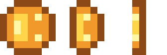
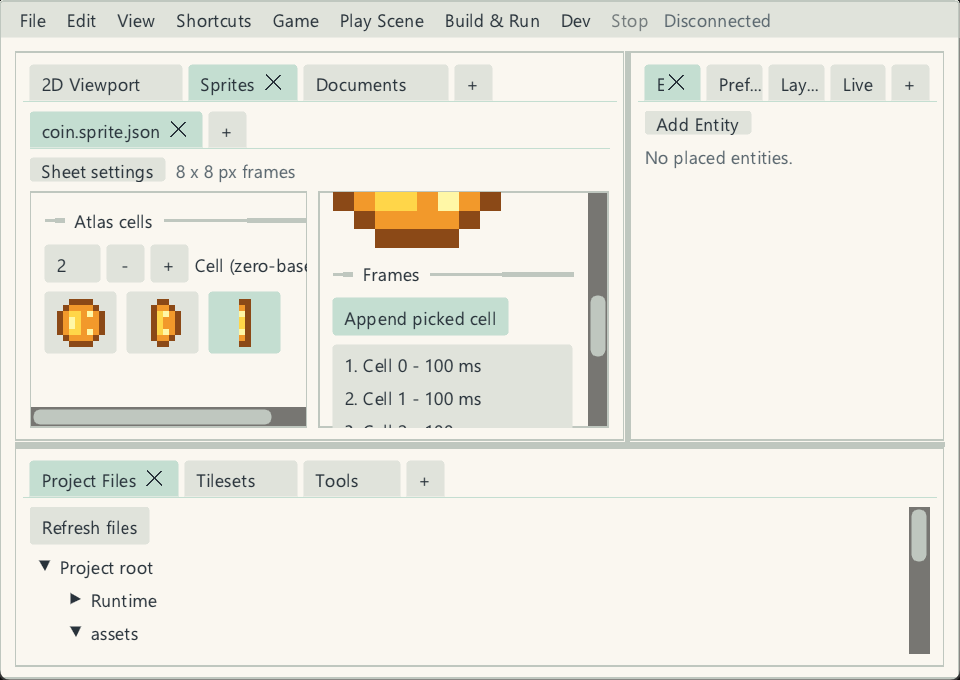
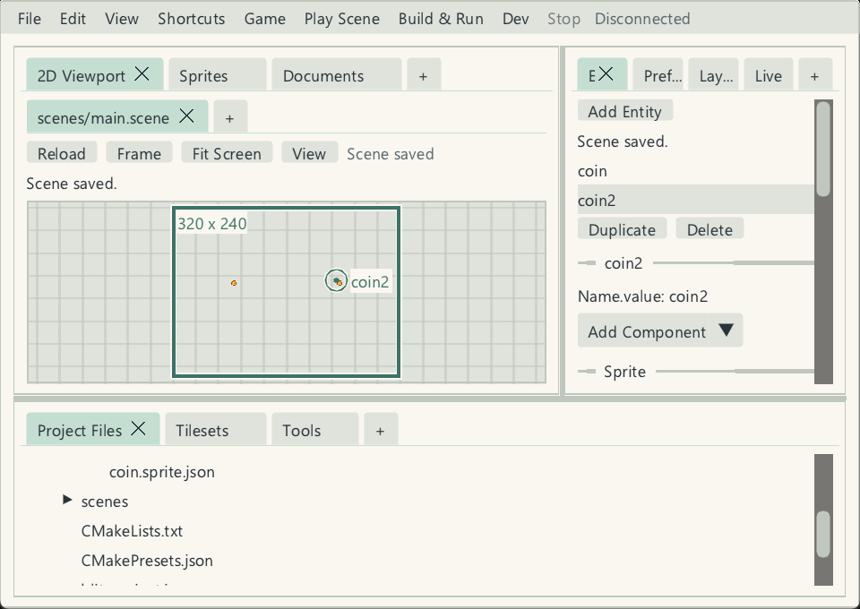
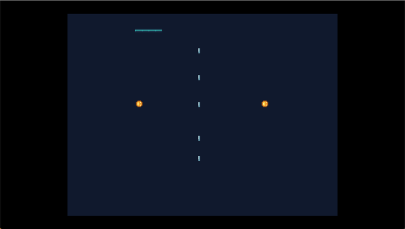
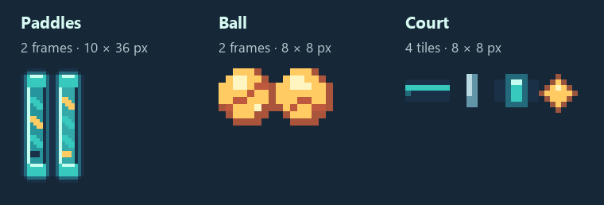

# Make a scene from a blank project

**Start here:** extract the entire Windows workshop ZIP to a writable folder, open `Editor/32blit-editor.exe`, then choose **File → New Project…**. You can finish this part without a compiler or a repository login. For dark mode use **View → Dark Mode** in the editor; the offline HTML guide has its own **Page theme** selector.

## 1. Create an empty game

Name the project `My Game`, click **Create…**, and pick the extracted **Scene Workshop** folder as its parent. The editor creates `My Game/` with `game.cpp`, a build recipe and a startup scene, `scenes/main.scene`. Leave the source alone for now. The PNGs in **Import These PNGs** are source art outside your new project; its `assets` folder starts empty.

**Check:** Choose **Play Scene**. A blank game window is correct; **Stop** it. This previews your saved scene without compiling game rules. Once you start changing C++, use the compiler instructions or **Build & Run** instead. Save project edits before launching either path.

## 2. Import a coin and animate it

1. Open **Sprites**. In that panel click **+ → Browse for PNG…** and select `Import These PNGs/coin.png`. Enter `assets/coin.sprite.json` as **Sprite file**, leave the project PNG copy path at its default, and click **Import**.
2. In **Sheet settings** set **Frame size (px)** to `8` by `8`, then **Apply grid**. The sheet is 24 pixels wide: you should see three cells, numbered `0`, `1`, and `2`.
3. Pick cell `0`, type `spin` under **Named clips → Name**, and click **Add clip**. This already adds frame zero. Pick `1` and click **Append picked cell**, then do the same for `2`. Leave **Loop** checked and the duration at `100` ms. Preview inside the Sprites panel. **File → Save All**.

**Check:** The coin turns from face-on to edge-on. You have defined an asset, not placed it in the scene yet. If the tabs do not fit, use the **+ on a dock** to show the panel; it is different from the **+ inside Sprites**.

## 3. Place two instances, without editing C++

1. Select **2D Viewport → `scenes/main.scene`**. In **Project Files** expand **Project root → assets**. Drag **`coin.sprite.json`** (not `coin.png`) from the file tree onto the left half of the game rectangle. Drop it again on the right half.
2. Under **Entities**, select `coin` or `coin2`. Each has a **Transform2D** at its drop position and a **Sprite** referencing `assets/coin`. The blank clip picks the first saved clip (`spin` here). Drag a marker to move it, or use **Edit → Set** on its `x` and `y` fields. **Edit → Undo Scene Edit** undoes an entire placement.
3. **Save All → Play Scene**. Both coins should animate. Stop, change one position, save and relaunch; only that coin moves. No asset list, renderer change or component registration is needed.

**Check:** One sprite descriptor and one PNG serve both actors. The SDK resolves the artwork at scene load; `game.cpp` does not contain the name `coin`.

## 4. Import a tileset and paint two layers

1. **Tilesets → + → Browse for PNG…**: pick `Import These PNGs/court.png`, name the descriptor `assets/court.tileset.json`, set the square tile size to `8`, and **Import**. The palette shows four swatches. Unlike sprite cells, a map tile ID of `0` means empty.
2. In **2D Viewport**, click the **+ next to the scene tab → New Tilemap**. Use `scenes/main.map`, **40** cells wide and **30** high, and choose `assets/court.tileset.json`. The map shares the startup scene's basename. Click **Create → Fit Map**.
3. In **Layers**, click the **Ground name**, not its checkbox. Select rail tile **1** in **Tilesets**, turn **Paint** on, and paint a few cells on row **2** and row **27** (top row is 0). These border the 320 × 240 court. Use **Eraser** to remove a misplaced cell.
4. In **Layers → Add Layer**, enter `Court Lines` and click **Create**. Select dash tile **2**, then paint dashes down the center, leaving a cell between them. Uncheck `Court Lines`: the dashes should disappear without hiding the rails. Check it again, then **Save All → Play Scene**.

**Check:** The same two coins animate over the two authored map layers. The `.map` stores placements; `.map.json` points to the tileset. Tile collision flags are not needed for Pong. You can build and share this coin scene as-is using the next part, or keep going to make Pong.

## 5. Turn the level into a Pong court

Keep working in `My Game`. Stop Play. On the `main.scene` tab select and delete the two coin **entities** (or keep them as animated decorations). Don't remove the map or edit the build recipe.

1. Import `paddles.png` through **Sprites → +** as `assets/paddle.sprite.json`. Apply a **10 × 36** frame grid. Choose cell `0`, add a `pulse` clip, select cell `1` and **Append picked cell**. For a slow pulse, select each frame row and set its duration to `440` and `220` ms respectively. Add a second clip `steady` starting at cell `0`; leave it with one frame.
2. Import `ball.png` as `assets/ball.sprite.json`. Apply an **8 × 8** grid. Make a looping `spin` clip with cells `0` and `1`, each `100` ms. **Save All**.
3. In **Prefabs → Add Prefab**, set **Key** to `paddle` and click **Create**. Expand it. Choose **Add Component → Transform2D → Add** with defaults. Add **Sprite**: check and fill `asset=assets/paddle`, `clip=pulse`, `offset_x=-5`, `offset_y=-18`. Add **BoxCollider2D** with `width=10`, `height=36`, `offset_x=-5`, `offset_y=-18`. Offsets center the picture and collider on the same position.
4. Choose **Entities → Add Entity**. Enter `player`, choose **Prefab → paddle**, and **Create**. Use **Edit → Set** for `Transform2D.x=24` and `y=120`. Make a second paddle instance called `opponent` at `(296,120)`. On this **instance**, override `Sprite.clip` to `steady`. Don't change the shared prefab. **Do not add PaddleDrive yet.**
5. Create a standalone entity called `ball` (Prefab: **None**). Add **Transform2D** at `(160,120)`, **Sprite** with `asset=assets/ball`, `clip=spin`, `offset_x=-4`, `offset_y=-4`, and **BoxCollider2D** with `width=8`, `height=8`, `offset_x=-4`, `offset_y=-4`. On standalone entities add the component, then change individual fields with **Edit → Set**.

**Check:** **Save All → Play Scene** shows two paddles and a spinning ball over your map. Z does **not** serve yet. Drawing a sprite and moving it are different jobs: the SDK already does the first; you will write the second. Stop the game before rebuilding.
