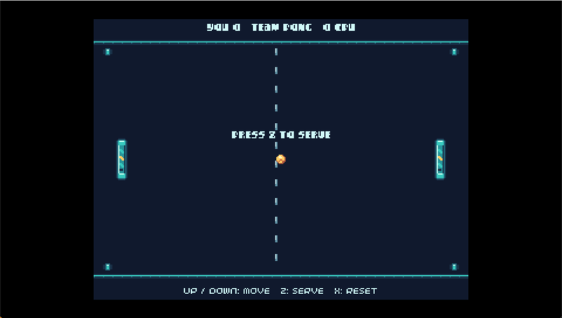

# Program Pong in seven checkpoints

Open **Project Files → game.cpp** in the editor, or open **`My Game/game.cpp`** in your code editor. It sits next to `CMakeLists.txt` in the folder you created with **File → New Project**. This is your working file for all seven checkpoints. The linked files in `Checkpoints/` are comparison copies, not files to edit or add to the build.

**How to apply the blocks:** Each function has a one-line `//` comment above it explaining its job. Treat the comment and function as one block. **Insert above** means paste before the existing function’s comment. **Replace** or **delete** means select from its comment through its matching closing `}`; leave the next function and its comment alone. Look for a definition such as `void update(`, not a call such as `move_player();`. Use the previous checkpoint link if you need to compare.

Save and build **after the last edit in each checkpoint**; halfway through, functions may still be missing. Use your compiler’s build/run commands or **Build & Run**. **Play Scene** previews the assets but does not run your C++ changes.

## 1. Clear the game window

Start by making a window you can recognize as your own build.

**Starting file: `My Game/game.cpp` as generated by New Project.** Select the entire file, from the first `#include` to the last `}`, and replace it with the block below. Leave your scene, artwork and `CMakeLists.txt` alone.

```cpp
#include "32blit.hpp"

using namespace blit;

// Set up the 320 by 240 game window.
void init() {
  set_screen_mode(ScreenMode::hires, Size(320, 240));
}

// Leave the game state unchanged while the window is blank.
void update(uint32_t) {}

// Clear the screen to navy for the first checkpoint.
void render(uint32_t) {
  screen.pen = Pen(16, 25, 45);
  screen.clear();
}
```

**What changed:** The starter used to draw your scene. Now `render()` picks a navy color and clears the window to that color every frame. A blank window is the expected result; your saved map and sprites are still on disk.

[Complete checkpoint 1 source](Checkpoints/01-blank/game.cpp).

**Check:** Build and launch your executable: the window is navy, with no court, coins or score. If the court still appears, you launched Play Scene instead of your executable.

## 2. Draw your own startup scene

Bring back the level you made in the editor, without adding any game rules yet.

**Starting file: `My Game/game.cpp` after [checkpoint 1](Checkpoints/01-blank/game.cpp).** Replace the entire contents of that same file with the block below. This version puts the scene back on screen.

```cpp
#include "32blit.hpp"
#include "game_scene.hpp"

using namespace blit;

sdk::GameScene game;

// Open the starting scene in a 320 by 240 window.
void init() {
  set_screen_mode(ScreenMode::hires, Size(320, 240));
  game.open();
}

// Leave the actors in place; drawing handles their animation.
void update(uint32_t) {}

// Clear the background, then draw the scene and its current animation frames.
void render(uint32_t time) {
  screen.pen = Pen(16, 25, 45);
  screen.clear();
  game.draw(time);
}
```

**What changed:** `game.open()` loads your starting scene once, in `init()`. Each frame, `game.draw(time)` draws the map and sprites over the navy background. Passing `time` lets the coin change animation frames even though `update()` is empty and the coin stays in place.

[Complete checkpoint 2 source](Checkpoints/02-draw-level/game.cpp).

**Check:** Your map and animated actors reappear. Nothing moves when you press the arrow keys.

## 3. Move one paddle

**Starting file: `My Game/game.cpp` after [checkpoint 2](Checkpoints/02-draw-level/game.cpp).** This time keep the file open and make three edits; do not replace the whole file.

Give the left paddle its first rule: follow the player’s input without crossing the rails.

**1. Replace the top of the file.** Select from the first `#include "32blit.hpp"` through `sdk::GameScene game;`, inclusive. Stop before `void init() {`. Paste:

```cpp
#include "32blit.hpp"
#include "game_scene.hpp"

#include <algorithm>

using namespace blit;
using sdk::BoxCollider2D;
using sdk::Transform2D;

sdk::GameScene game;

constexpr float court_top = 24.0f;
constexpr float court_bottom = 216.0f;
constexpr float tick_seconds = 0.010f; // update() runs every 10 ms.
```

**What changed:** The movement code now has two court limits (`24` and `216` pixels) and a time step (`0.010` seconds). `<algorithm>` makes `std::clamp` available to keep a value between two limits. These declarations don’t move anything yet.

**2. Insert four functions.** Find `void init() {`. Paste the following block above its `// Open the starting scene…` comment, after the `tick_seconds` declaration. Keep `init()` and its comment together.

```cpp
// Return -1 for up, +1 for down, or 0 when the inputs cancel.
int player_direction() {
  int direction = 0;
  if (sdk::button_down(Button::DPAD_UP)) {
    direction -= 1;
  }
  if (sdk::button_down(Button::DPAD_DOWN)) {
    direction += 1;
  }
  return direction;
}

// Check that the collision box has a usable size and fits between the rails.
bool fits_court(const BoxCollider2D &box) {
  return box.width > 0 && box.height > 0 && box.height <= court_bottom - court_top;
}

// Move a paddle vertically without letting its collision box cross a rail.
void move_paddle(Transform2D &paddle, const BoxCollider2D &box, float distance) {
  // Stop at the edge of the collider, even when the sprite has a different size.
  const float top = court_top - box.offset_y;
  const float bottom = court_bottom - box.offset_y - box.height;
  paddle.y = std::clamp(paddle.y + distance, top, bottom);
}

// Move the player paddle one step in the direction of the held keys.
void move_player() {
  Transform2D *player = game.position("player");
  const BoxCollider2D *box = game.collider("player");
  if (player && box && fits_court(*box)) {
    move_paddle(*player, *box, player_direction() * 170.0f * tick_seconds);
  }
}
```

**What changed:** `player_direction()` returns −1 for Up, +1 for Down, and 0 when neither or both are held. `move_player()` finds the actor named `player` and checks its collision box. `move_paddle()` then changes that actor’s `y` position by at most 1.7 pixels per tick (`170 × 0.010`), keeping the whole box inside the court. These functions are defined now, but nothing calls `move_player()` yet.

**3. Replace the empty update.** In `My Game/game.cpp`, just below `init()`, find this exact two-line block from checkpoint 2:

```cpp
// Leave the actors in place; drawing handles their animation.
void update(uint32_t) {}
```

Select both lines and replace them with the block below. Leave `render()` and its comment underneath unchanged.

```cpp
// Read player input and move the paddle once per tick.
void update(uint32_t) {
  move_player();
}
```

**What changed:** The old `update()` did nothing. The SDK calls `update()` every 10 ms, so putting `move_player()` here makes a held key move the paddle repeatedly. `render()` already draws the paddle at its current position; it doesn’t need to change.

[Complete checkpoint 3 source](Checkpoints/03-move-paddle/game.cpp).

**Check:** Hold Up or Down: only the left paddle moves, and the collider stops at the rails. Hold both directions: they cancel.

## 4. Serve and bounce off the walls

**Starting file: `My Game/game.cpp` after [checkpoint 3](Checkpoints/03-move-paddle/game.cpp).** Keep the paddle movement you just built.

Let the player position the paddle before serving. For this checkpoint, the ball can bounce off the walls but not off the paddles.

Find the declaration starting with `constexpr float tick_seconds`. Insert these variables on a new line **below** it and **above** `int player_direction() {`:

```cpp
constexpr float ball_speed = 190.0f;

float vx = 0.0f;
float vy = 0.0f;
bool waiting = true;
```

**What changed:** `vx` and `vy` remember how fast the ball is moving sideways and vertically between updates. They start at zero, and `waiting` starts true so the ball stays where you placed it until the first serve.

Find `int player_direction() {`. Insert `restart_rally()` above its comment, after the new `bool waiting = true;` declaration:

```cpp
// Wait for a new serve after loading the court.
void restart_rally() {
  waiting = true;
}
```

**What changed:** `restart_rally()` puts the game back into the waiting state. It doesn’t move the ball or choose a speed; the next serve will set both velocity values.

Find `void init() {`. Insert both functions below above its comment, after the closing `}` of `move_player()`. Do not put them inside `init()`.

```cpp
// Start a waiting rally with a practice shot toward the lower left.
void serve() {
  if (waiting && sdk::button_pressed(Button::A)) {
    vx = -ball_speed;
    vy = 140.0f; // This practice serve reaches the bottom wall before the left goal.
    waiting = false;
  }
}

// Move the ball one tick and bounce it off the top or bottom rail.
void advance_ball(Transform2D &ball, const BoxCollider2D &box) {
  ball.x += vx * tick_seconds;
  ball.y += vy * tick_seconds;

  const float top = court_top - box.offset_y;
  const float bottom = court_bottom - box.offset_y - box.height;
  if (ball.y < top && vy < 0.0f) {
    ball.y = top;
    vy = -vy;
  } else if (ball.y > bottom && vy > 0.0f) {
    ball.y = bottom;
    vy = -vy;
  }
}
```

**What changed:** Pressing Z while waiting sets the ball moving left (`vx` is negative) and down (`vy` is positive). `advance_ball()` turns those speeds into distance for one tick. At a horizontal rail it puts the ball back against the rail and reverses only `vy`, so the ball keeps travelling left after the bounce.

Find `void init() {`, which currently calls `game.open();`. Replace that whole function with the block below. Stop before `void update(uint32_t) {`.

```cpp
// Load the court and wait for a serve before the ball moves.
void init() {
  set_screen_mode(ScreenMode::hires, Size(320, 240));
  game.open(restart_rally);
}
```

**What changed:** `game.open()` now takes the name `restart_rally`, **without parentheses**. That gives the SDK a function to call after a successful scene load. Reloading the court now waits for a fresh serve instead of continuing the old rally.

Find `void update(uint32_t) {` between `init()` and `render()`. It currently contains just `move_player();`. Replace its purpose comment and the three-line definition with:

```cpp
// Move the paddle, then serve or advance the ball if it is in play.
void update(uint32_t) {
  move_player();

  Transform2D *ball = game.position("ball");
  const BoxCollider2D *box = game.collider("ball");
  if (!ball || !box || !fits_court(*box)) {
    return;
  }

  serve();
  if (!waiting) {
    advance_ball(*ball, *box);
  }
}
```

**What changed:** Each tick still moves the paddle first. It then looks up the ball and its box; if either is missing or the box doesn’t fit, the tick stops safely. Otherwise it checks for a serve and moves the ball only when `waiting` is false. You can position the paddle while the ball waits.

[Complete checkpoint 4 source](Checkpoints/04-serve-walls/game.cpp).

**Check:** Z sends the ball down-left. It bounces off the bottom wall but passes through a paddle. Relaunch to serve again.

## 5. Return the ball with a paddle

**Starting file: `My Game/game.cpp` after [checkpoint 4](Checkpoints/04-serve-walls/game.cpp).** You’ll keep the serve and wall bounce, but change how paddles are updated.

Make a paddle hit different from a wall bounce: the spot where you hit the ball should affect its return angle.

Find the **definition** starting with `void move_player() {`. Delete its comment and the entire function through its closing `}`. Keep `serve()` and its comment. For now leave the call `move_player();` inside `update()`; the last edit in this checkpoint replaces that function.

**What changed:** You’ve removed the helper that controlled just the left paddle. A single loop below will handle both paddles. The file won’t build until you also replace the old call in `update()`.

Find `int player_direction() {`. Insert the following declarations above its comment, **outside** `restart_rally()`. Both paddles can return the ball, but only the player takes keyboard input:

```cpp
struct PaddleSettings {
  const char *name;
  float speed;
  bool computer;
};

constexpr PaddleSettings paddles[] = {
  {"player", 170.0f, false},
  {"opponent", 92.0f, true}
};
```

**What changed:** Each row pairs a scene actor’s name with a speed and a control choice. The next loop can visit both paddles without repeating their collision code. Setting `computer` to `true` does **not** make the opponent chase the ball yet; it just keeps keyboard input from moving it.

Find `void init() {`. Insert `return_hit()` and `update_paddles()` above its comment, after the end of `advance_ball()`. Keep all three existing callbacks (`init`, `update`, `render`).

```cpp
// Bounce the ball only if its leading edge crosses the face of a paddle.
bool return_hit(Transform2D &ball, const sdk::Box &before, const sdk::Box &next, const sdk::Box &paddle) {
  if (next.top >= paddle.bottom || next.bottom <= paddle.top) {
    return false;
  }

  // Did the ball's leading edge cross the paddle's face during this tick?
  if (vx > 0.0f && before.right <= paddle.left && next.right >= paddle.left) {
    ball.x += paddle.left - next.right;
  } else if (vx < 0.0f && before.left >= paddle.right && next.left <= paddle.right) {
    ball.x += paddle.right - next.left;
  } else {
    return false;
  }

  vx = -vx;
  // A centre hit flies straight; hitting near an end gives a steeper return.
  const float half_height = (paddle.bottom - paddle.top) / 2.0f;
  const float offset = (sdk::center_y(next) - sdk::center_y(paddle)) / half_height;
  vy = std::clamp(offset, -1.0f, 1.0f) * 150.0f;
  return true;
}

// Move the player and check both paddles for a return.
void update_paddles(Transform2D &ball, const sdk::Box &before, const sdk::Box &next) {
  const int direction = player_direction();
  bool hit = false;

  for (const PaddleSettings &paddle : paddles) {
    Transform2D *position = game.position(paddle.name);
    const BoxCollider2D *box = game.collider(paddle.name);
    if (!position || !box || !fits_court(*box)) {
      continue;
    }

    if (!paddle.computer) {
      move_paddle(*position, *box, direction * paddle.speed * tick_seconds);
    }

    // The first return wins; the other paddles still get to move.
    if (!waiting && !hit) {
      hit = return_hit(ball, before, next, sdk::bounds(*position, *box));
    }
  }
}
```

**What changed:** `return_hit()` checks that the ball overlaps the paddle vertically **and** that its front edge crossed the paddle face during this tick. On a hit, it puts the ball against that face and reverses `vx`. A center hit sets `vy` to zero; an off-center hit sends the ball up or down. `update_paddles()` allows just one return per tick so the same step can’t reverse the ball twice.

Find `void update(uint32_t) {`; its first statement is still `move_player();`. Replace its comment and the whole function through its closing `}` with the block below. Keep `render()` and its comment.

```cpp
// Track the ball before and after each step so paddles can return it.
void update(uint32_t) {
  Transform2D *ball = game.position("ball");
  const BoxCollider2D *box = game.collider("ball");
  if (!ball || !box || !fits_court(*box)) {
    return;
  }

  serve();
  const sdk::Box before = sdk::bounds(*ball, *box);
  sdk::Box next = before;
  if (!waiting) {
    advance_ball(*ball, *box);
    next = sdk::bounds(*ball, *box);
  }
  update_paddles(*ball, before, next);
}
```

**What changed:** `update()` now saves the ball’s box **before** moving it and measures it again **afterward**. It passes both boxes to `update_paddles()`. That’s how the collision check can tell that the ball crossed a face, rather than merely finding it near a paddle.

[Complete checkpoint 5 source](Checkpoints/05-paddle-hit/game.cpp).

**Check:** Move the player down before serving. The practice serve bounces off the wall, strikes the paddle and travels right. Relaunch to try a miss.

## 6. Give the CPU a speed limit

**Starting file: `My Game/game.cpp` after [checkpoint 5](Checkpoints/05-paddle-hit/game.cpp).** Only paddle behavior changes. Leave `update()` alone in this checkpoint.

Give the opponent a chance to return a serve without making it unbeatable.

Find the definition starting with `void update_paddles(`. Insert `move_cpu()` above its comment, after the closing `}` of `return_hit()`:

```cpp
// Chase the ball without moving farther than the CPU can travel in one tick.
void move_cpu(Transform2D &paddle, const BoxCollider2D &box, const sdk::Box &ball, float step) {
  const sdk::Box paddle_bounds = sdk::bounds(paddle, box);
  const float gap = sdk::center_y(ball) - sdk::center_y(paddle_bounds);
  // Stop at the ball's height if it is closer than one step.
  move_paddle(paddle, box, std::clamp(gap, -step, step));
}
```

**What changed:** `gap` measures how far the paddle’s center is from the ball’s center. If the ball is far away, the CPU moves only one allowed step toward it. If it’s closer than one step, the CPU moves just the remaining distance and doesn’t overshoot.

Immediately below your new `move_cpu()`, find the **definition** starting with `void update_paddles(`. Replace it through its closing `}`, stopping before `void init() {`. Do **not** edit the `update_paddles(*ball, before, next);` call in `update()`.

```cpp
// Move the player and CPU, allowing at most one paddle return per tick.
void update_paddles(Transform2D &ball, const sdk::Box &before, const sdk::Box &next) {
  const int direction = player_direction();
  bool hit = false;

  for (const PaddleSettings &paddle : paddles) {
    Transform2D *position = game.position(paddle.name);
    const BoxCollider2D *box = game.collider(paddle.name);
    if (!position || !box || !fits_court(*box)) {
      continue;
    }

    const float step = paddle.speed * tick_seconds;
    if (paddle.computer) {
      move_cpu(*position, *box, next, step);
    } else {
      move_paddle(*position, *box, direction * step);
    }

    // The first return wins; the other paddles still get to move.
    if (!waiting && !hit) {
      hit = return_hit(ball, before, next, sdk::bounds(*position, *box));
    }
  }
}
```

**What changed:** Both paddles still use the same loop and hit check. The difference is the `computer` branch: it now calls `move_cpu()` for the opponent instead of leaving it still. The player still follows the keys. At the table’s `92` pixels per second, the opponent can move at most `0.92` pixels per tick.

[Complete checkpoint 6 source](Checkpoints/06-cpu/game.cpp).

**Check:** Serve: the opponent moves toward the ball. Watch a steep return: the CPU cannot instantly match its height.

## 7. Score, reset and expose paddle settings

**Starting file: `My Game/game.cpp` after [checkpoint 6](Checkpoints/06-cpu/game.cpp).** This is the only checkpoint that also changes the build recipe and adds two source files.

Finish the match rules and let a level designer choose each paddle’s role and speed in the editor.

**7a — add an editable component.** Create two **new** files, `My Game/paddle.hpp` and `My Game/paddle.cpp`, in the same folder as `game.cpp` and `CMakeLists.txt`. Put each block in the file named above it, not in `game.cpp`.

**`paddle.hpp`**

```cpp
#pragma once

struct PaddleDrive {
  float speed = 170.0f; // Pixels per second.
  bool computer = false;
};
```

**What changed:** `PaddleDrive` groups two settings that belong to one paddle. A paddle with this component defaults to keyboard control at 170 pixels per second. Defining the struct does not attach it to any actor or move a paddle.

**`paddle.cpp`**

```cpp
#include "paddle.hpp"
#include "registry.hpp"

SDK_COMPONENT(PaddleDrive, speed, computer);
```

**What changed:** `SDK_COMPONENT` tells the SDK the names of the two fields. That lets a scene save `speed` and `computer` by name, and lets the editor show those settings once you build and reopen the project.

Open **`My Game/CMakeLists.txt`** (not `CMakePresets.json`). Replace its entire contents with [checkpoint 7’s CMakeLists.txt](Checkpoints/07-finished/CMakeLists.txt) and save it. Keep your manifest, presets and artwork.

**What changed:** Building the same `game` target now compiles `paddle.cpp` and updates the project’s `registry.json`. The executable can load `PaddleDrive`, and the editor can offer it in **Add Component**. You don't need to write the JSON yourself.

**7b — implement match rules.** Switch back to **`My Game/game.cpp`**. All the remaining C++ blocks go in that file. Finish them before you rebuild.

Replace the top of the file, starting at its first `#include` and ending at `bool waiting = true;`, inclusive. Stop before the line `void restart_rally() {`. Paste:

```cpp
#include "32blit.hpp"
#include "game_scene.hpp"
#include "paddle.hpp"

#include <algorithm>
#include <cstdio>

using namespace blit;
using sdk::BoxCollider2D;
using sdk::Transform2D;

sdk::GameScene game;

constexpr float court_top = 24.0f;
constexpr float court_bottom = 216.0f;
constexpr float tick_seconds = 0.010f; // update() runs every 10 ms.
constexpr float ball_speed = 190.0f;

float vx = 0.0f;
float vy = 0.0f;
bool waiting = true;
Transform2D serve_position;
int serve_direction = -1;
unsigned int player_score = 0;
unsigned int cpu_score = 0;
```

**What changed:** The game now remembers each side’s score, where the ball should return after a point, and which way to serve next. These values live outside the functions so they survive from one tick to the next. `<cstdio>` supplies the text-formatting function the scoreboard will use.

Find `void restart_rally() {`. Delete from its comment through the `};` ending the `paddles[]` table, inclusive. This removes the old restart function, `struct PaddleSettings` and the two hard-coded entries. Keep `player_direction()` and its comment.

**What changed:** The two paddle roles and speeds are no longer fixed in a C++ table. Later in this checkpoint you’ll set them on the scene actors instead, so changing the opponent’s speed won’t require a code edit.

Insert `reset_match()` and `start_match()` in that gap: below `unsigned int cpu_score = 0;` and above the comment for `player_direction()`.

```cpp
// Clear both scores and wait for the first serve of a new match.
void reset_match() {
  player_score = 0;
  cpu_score = 0;
  serve_direction = -1;
  waiting = true;
}

// Remember the ball's starting position and reset the match on scene load.
void start_match() {
  const Transform2D *ball = game.position("ball");
  if (ball) {
    serve_position = *ball;
  }
  reset_match();
}
```

**What changed:** `start_match()` reads the ball’s position from the loaded scene and remembers it as the serve spot. `reset_match()` clears the scores, points the first serve left, and waits for Z. Keeping those jobs separate means pressing X mid-rally won’t accidentally make the ball’s current position the new serve spot.

Find `void serve() {`, which currently sets `vx = -ball_speed;`. Replace this function through its closing `}`, stopping before `void advance_ball(`:

```cpp
// Launch the next serve using the last goal and total points to choose its direction.
void serve() {
  if (waiting && sdk::button_pressed(Button::A)) {
    vx = serve_direction * ball_speed;
    const unsigned int points_played = player_score + cpu_score;
    if (points_played % 2 == 0) {
      vy = 74.0f;
    } else {
      vy = -74.0f;
    }
    waiting = false;
  }
}
```

**What changed:** A serve no longer always goes down-left. `serve_direction` chooses left or right. The total score chooses the vertical direction: at 0–0 it goes down; after one point it goes up. The smaller vertical speed gives a shallower serve than the practice shot.

Find the definition starting with `void update_paddles(`, immediately after `move_cpu()`. Replace the entire function up to, but not including, `void init() {`. The new version reads `PaddleDrive` instead of the deleted `paddles[]` table.

```cpp
// Use each paddle's settings to move it and check for a return.
void update_paddles(Transform2D &ball, const sdk::Box &before, const sdk::Box &next) {
  const int direction = player_direction();
  bool hit = false;

  // Read the current components each tick: role, speed and even the actors can change live.
  for (uint16_t slot = 0; slot < game.world.capacity(); ++slot) {
    const sdk::Entity actor = game.world.entity_at(slot);
    const PaddleDrive *drive = game.world.get<PaddleDrive>(actor);
    if (!drive) {
      continue;
    }
    Transform2D *position = game.world.get<Transform2D>(actor);
    const BoxCollider2D *box = game.world.get<BoxCollider2D>(actor);
    if (!position || !box || !fits_court(*box)) {
      continue;
    }

    const float step = std::max(0.0f, drive->speed) * tick_seconds;
    if (drive->computer) {
      move_cpu(*position, *box, next, step);
    } else {
      move_paddle(*position, *box, direction * step);
    }

    // The first return wins; the other paddles still get to move.
    if (!waiting && !hit) {
      hit = return_hit(ball, before, next, sdk::bounds(*position, *box));
    }
  }
}
```

**What changed:** The loop now looks for `PaddleDrive` on scene actors instead of looking up two names in a table. An actor with that component, a position and a usable box moves according to its own `speed` and `computer` settings. A paddle sprite without `PaddleDrive` will still be drawn, but this loop won’t move it or bounce the ball off it.

Insert `check_goal()` above the comment for `void init() {`, after the closing `}` of the new `update_paddles()`:

```cpp
// Award a point when the whole ball leaves the court, then set up the next serve.
void check_goal(Transform2D &ball, const sdk::Box &box) {
  // A point counts only when the whole ball has left the court.
  if (box.right < 0.0f) {
    cpu_score += 1;
    serve_direction = -1;
  } else if (box.left > 320.0f) {
    player_score += 1;
    serve_direction = 1;
  } else {
    return;
  }
  ball = serve_position;
  waiting = true;
}
```

**What changed:** A ball partly offscreen is still in play. Once its **right** edge passes the left boundary, the CPU scores; once its **left** edge passes the right boundary, the player scores. After either point the ball returns to the saved serve spot and waits for Z.

Find `void init() {`, which still calls `game.open(restart_rally);`. Replace that entire function, stopping before `void update(uint32_t) {`, with:

```cpp
// Set up paddle controls and load the court for a new match.
void init() {
  set_screen_mode(ScreenMode::hires, Size(320, 240));
  static sdk::ComponentPool<PaddleDrive> drives(game.world, game.world.capacity());
  game.open(start_match);
}
```

**What changed:** Before loading the scene, `init()` gives the game storage for its new `PaddleDrive` components. It also replaces `restart_rally` with `start_match` as the load callback, so the serve spot and score are initialized for the court you actually opened.

Find `void update(uint32_t) {` between `init()` and `render()`. The old version ends with `update_paddles(*ball, before, next);`. Replace the comment and the whole `update()` definition. Keep `render()` and its comment for the next edit.

```cpp
// Run one match tick, including input, paddle hits, goals and reset.
void update(uint32_t) {
  Transform2D *ball = game.position("ball");
  const BoxCollider2D *box = game.collider("ball");
  if (!ball || !box || !fits_court(*box)) {
    return;
  }

  if (sdk::button_pressed(Button::B)) {
    *ball = serve_position;
    reset_match();
    return;
  }

  serve();
  const sdk::Box before = sdk::bounds(*ball, *box);
  sdk::Box next = before;
  if (!waiting) {
    advance_ball(*ball, *box);
    next = sdk::bounds(*ball, *box);
  }
  update_paddles(*ball, before, next);

  if (!waiting) {
    // A paddle hit may have moved the ball back onto the court.
    check_goal(*ball, sdk::bounds(*ball, *box));
  }
}
```

**What changed:** X now returns the ball to its serve spot and resets the score before any movement happens that tick. During a rally, the goal check runs **after** the paddle hit check and uses the ball’s corrected position. A successful return near the edge is therefore not mistaken for a goal.

At the bottom of `My Game/game.cpp`, find `void render(uint32_t time) {`. Replace from its comment through the last `}` in the file with the block below. Do not append a second `render()`.

```cpp
// Draw the court and actors, then add the score and serve prompt.
void render(uint32_t time) {
  screen.pen = Pen(16, 25, 45);
  screen.clear();
  if (!game.draw(time)) {
    return; // Leave the SDK's scene error visible instead of drawing a scoreboard on it.
  }

  char hud[64];
  std::snprintf(hud, sizeof(hud), "YOU %u   TEAM PONG   %u CPU", player_score, cpu_score);
  screen.pen = Pen(208, 248, 248);
  screen.text(hud, fat_font, Point(160, 3), true, TextAlign::top_center);
  screen.text("UP / DOWN: MOVE   Z: SERVE   X: RESET", minimal_font,
              Point(160, 229), true, TextAlign::top_center);
  if (waiting) {
    screen.text("PRESS Z TO SERVE", fat_font, Point(160, 95), true, TextAlign::top_center);
  }
}
```

**What changed:** `render()` still draws the court and actors first. It now draws the current score and controls on top, and shows “PRESS Z TO SERVE” only while the ball is waiting. If the scene fails to draw, it leaves the SDK’s error message visible instead of covering it with a scoreboard.

**7c — connect the authored paddles.** Build `game` once so the editor receives the new component schema. Stop the game and reopen `My Game` with **File → Open Project…**. Select the `paddle` prefab, add **PaddleDrive** and leave its fields unchecked (`speed=170`, `computer=false` at runtime). Select the `opponent` instance and override `speed=92`, `computer=true`. Save All. The `player` inherits the defaults. From now on use **Build & Run** or your own executable, not the built-in-only **Play Scene** runner.

**What changed:** Both paddle instances inherit keyboard control from the prefab, but the opponent’s overrides give it CPU control at 92 pixels per second. On the next launch the same game code reads those different settings and controls each paddle accordingly.

[Complete checkpoint 7 source](Checkpoints/07-finished/game.cpp).

**Check:** Miss left: CPU gets a point and the ball waits at its authored position. Z serves again. X resets the match and score. Lower the opponent’s speed in the editor, save and relaunch your compiled game.



## If the result is different

| Symptom | Check |
|---|---|
| Animation works but none of my C++ changes do | **Play Scene** runs the built-in player. Use **Build & Run** or build and launch your own `game` target. |
| The player reports an unknown component | If you have added `PaddleDrive`, use checkpoint 7's compiled executable, not the generic preview or an earlier checkpoint. |
| A sprite is missing or a reload fails | Read the file and clip name in the runtime error/Build & Game Log. `Sprite.asset` is a project-relative descriptor stem, e.g. `assets/coin`, without `.sprite.json` or `.png`. The clip name must match exactly. |
| CMake can't find 32BLIT or SDL | Pass the full extracted `32blit-sdk` path; use matching MSVC or UCRT64 SDL settings. Do not reuse the other compiler's build folder. |
| A copied checkpoint seems to run the previous lesson | Some file-copy tools preserve the older timestamp. Save `game.cpp` in your editor and rebuild. After changing `CMakeLists.txt`, repeat the configure command before building. |
| The exported game runs blank on another machine | Share the whole Release `dist/bin/` folder with its `data` and DLLs, and check that the startup scene in its manifest is yours. |

To experiment, save the game, add a third sprite or another tile layer in the editor and run again. The artwork should appear without changing `game.cpp`. Change `check_goal()` instead and rebuild: that's a game rule, not an asset.
